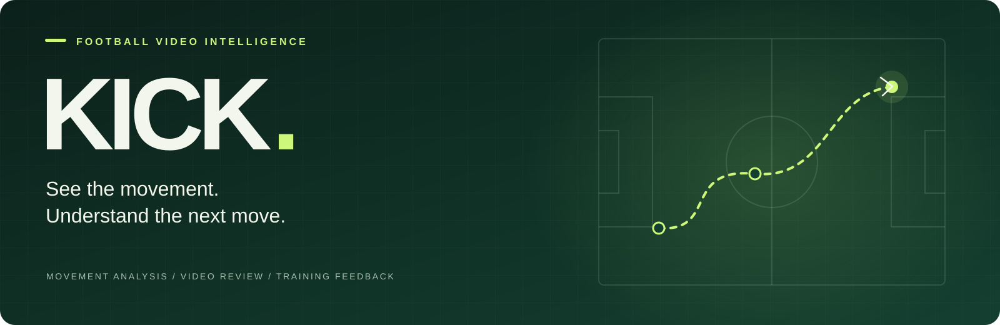

<div align="center">



# Kick

### Your footage. Clearer feedback. More purposeful training.

An AI-assisted football training companion, built to turn video into a clearer understanding of your game.

**English** · [简体中文](README.zh-CN.md)

[Why Kick](#built-for-the-work-between-matches) · [The Experience](#a-clearer-training-loop) · [Quick Start](#quick-start) · [Documentation](backend/README.md)

<sub>Football-first analysis · Video-led review · Native iOS experience</sub>

</div>

---

## Built for the Work Between Matches

The effort happens on the pitch. Understanding that effort takes reflection: how did you set up the pass, where did control break down, and what deserves your attention next?

Kick is designed for players who want to train with a purpose. It brings football movement analysis, video review, and practical feedback into one workflow, helping you move from watching a clip to choosing a focus for your next session.

**The product ambition is simple: make useful training feedback part of everyday football.**

## See the Action. Find Your Focus.

<table>
<tr>
<td width="33%" valign="top"><strong>SEE YOUR TECHNIQUE</strong><br /><br />Look closer at preparation, support, contact, and follow-through, with football-specific movement assessment.</td>
<td width="33%" valign="top"><strong>UNDERSTAND THE FEEDBACK</strong><br /><br />Read issue explanations and training cues alongside scores, so the review has a practical direction.</td>
<td width="33%" valign="top"><strong>RETURN WITH INTENT</strong><br /><br />Revisit the footage and training history to choose what you want to work on next.</td>
</tr>
</table>

### Built Around Football

A pass, a shot, and a first touch each ask something different of the player. Kick's analysis follows that distinction, with action-specific templates and feedback grounded in football movements.

| Training focus | What the experience is designed to help you examine |
| --- | --- |
| **Passing** | Preparation, support-foot position, contact, and control stability |
| **Shooting** | How the movement comes together through setup, strike, and follow-through |
| **Receiving** | First-touch preparation, control, and readiness for the next action |
| **Pass-receive sequences** | How individual movements connect across a continuous sequence |
| **Single-player long video** | A developing workflow for following one player and locating candidate action moments |

### Feedback You Can Put Back Into Practice

Kick's feedback combines movement scores, phase-level assessment, issue explanations, and next-step cues. The aim is to give each review a useful destination: a specific part of the action to pay attention to when you train again.

Video remains central to the experience. Return to the original movement, read the feedback in context, and use it to guide your own review.

### A Companion Across Sessions

Upload, analysis, playback, and history are brought together in a native iOS app. Kick is designed to make reviewing a session a natural part of the training routine, with previous footage and feedback available through the history experience.

## A Clearer Training Loop

1. **Pick your focus.** Choose the football action you want to review.
2. **Bring your footage.** Upload a clip from the iOS app.
3. **Explore the feedback.** Review movement scores, issue descriptions, and analysis quality.
4. **Take a focus forward.** Revisit the video and choose what to pay attention to next time.

**Capture → Understand → Review → Train with intent**

## The Bigger Picture

Kick's core is the relationship between a player, their footage, and their next training session. The broader product direction connects that individual experience with the football around them: places to play, people to learn with, and opportunities to keep training.

The repository includes community, venue search, coach listing, and booking interfaces as foundations for that direction. These areas are still being developed and validated.

## Product & Engineering

The experience is supported by a SwiftUI iOS app and a Python/FastAPI analysis service, using OpenCV and MediaPipe for vision processing.

<details>
<summary><strong>Explore the implementation</strong></summary>

| Foundation | Implementation |
| --- | --- |
| Football-specific analysis | [Action routing](backend/analysis/analyzer_router.py) · [Movement scoring](backend/analysis/football_scoring.py) |
| Quality context | [Frame rate, pose visibility, and ball-track checks](backend/quality_gate.py) |
| Target continuity | [Position, scale, and appearance tracking](backend/analysis/target_tracking.py) |
| App and service | [iOS guide](ios/KickAI/README.md) · [Backend & API](backend/README.md) |

</details>

### Availability & Analysis Scope

Kick is in active development. This repository contains the current implementation; the product direction above is not a claim of production readiness or independently validated training outcomes. Long-video and discovery flows require further scenario-specific validation, and coaching interfaces do not establish live service fulfillment.

Analysis depends on filming conditions and movement type. Interpret feedback alongside the original footage and check analysis status and warnings; successful HTTP requests alone do not establish valid results.

## Quick Start

### 1. Start the Analysis Service

Requires Python 3.10 or later. Dependencies are not pinned; verify compatibility in your local environment.

```bash
git clone https://github.com/kodiak-10/kick.git
cd kick/backend
python3 -m venv .venv
source .venv/bin/activate
python -m pip install -r requirements.txt
python -m uvicorn main:app --host 0.0.0.0 --port 8000
```

Once running, open the [health endpoint](http://127.0.0.1:8000/health) and [interactive API documentation](http://127.0.0.1:8000/docs). Confirm that video analysis is available in the health response and inspect startup warnings.

See the [backend guide](backend/README.md) for map configuration, upload examples, and analysis status details.

### 2. Run the iOS App

1. On macOS, open `ios/KickAI/Kick.xcodeproj` in Xcode with support for the iOS 17 SDK.
2. Select the `KickAI` scheme and a simulator or device running iOS 17 or later.
3. The simulator connects to `http://127.0.0.1:8000` by default. For a physical device, set the following under **Edit Scheme → Run → Arguments → Environment Variables**:

```text
KICKAI_ANALYZE_DEVICE_BASE_URL=http://<your-Mac-LAN-IP>:8000
```

The device and Mac must be able to reach each other over the network. See the [iOS guide](ios/KickAI/README.md) for full configuration.

## Repository Guide

```text
kick/
├── ios/KickAI/          Primary SwiftUI app, Xcode project, and tests
├── ios/AICoach/         Earlier iOS implementation retained for reference
├── backend/
│   ├── main.py         FastAPI entry point
│   ├── analysis/       Action routing, video analysis, tracking, and scoring
│   ├── vision/         Pose detection and keypoint processing
│   ├── tests/          Backend tests and samples
│   ├── docs/           Research, usage guides, and plans
│   └── schemas/        Data structure definitions
└── docs/               Web demos
```

The code and current API define implemented behavior. Planning documents in `backend/docs/` also include ideas that have not yet been implemented.

## Development & Validation

Backend tests:

```bash
cd backend
python -m pytest
```

For iOS tests, select the `KickAI` scheme in Xcode and choose **Product → Test**.

The test directories cover action routing, scoring, video result consistency, and client models, among other areas. Test results must be established by running the relevant checks.

## Feedback & Contributions

Report problems through [Issues](https://github.com/kodiak-10/kick/issues). Include reproduction steps, your environment, the selected action, and the actual result. Remove personal information and credentials before sharing footage or logs.

For changes, describe the purpose and validation performed. Keep map credentials, user videos, local databases, and generated reports out of the repository.
