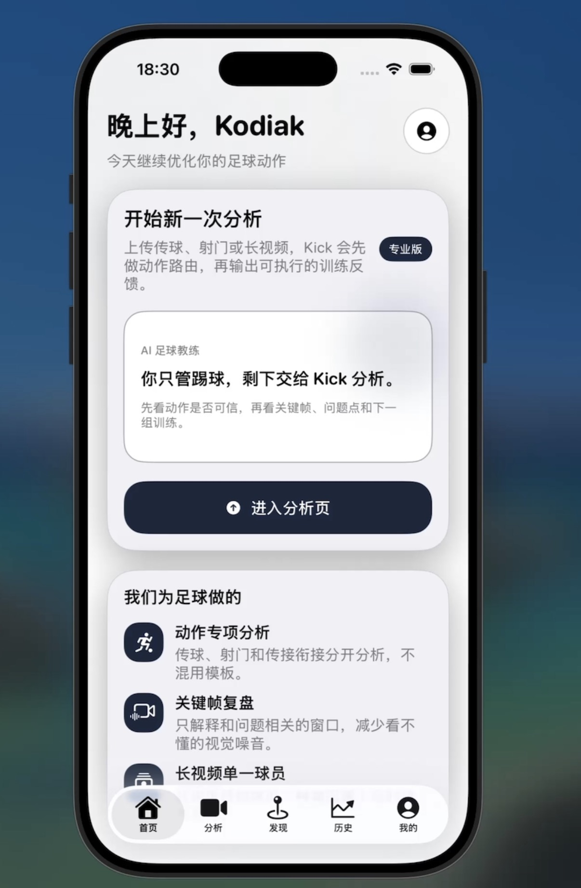
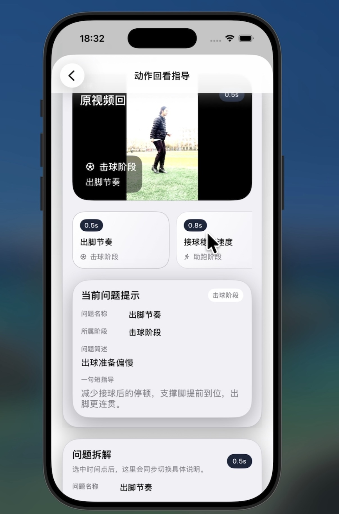
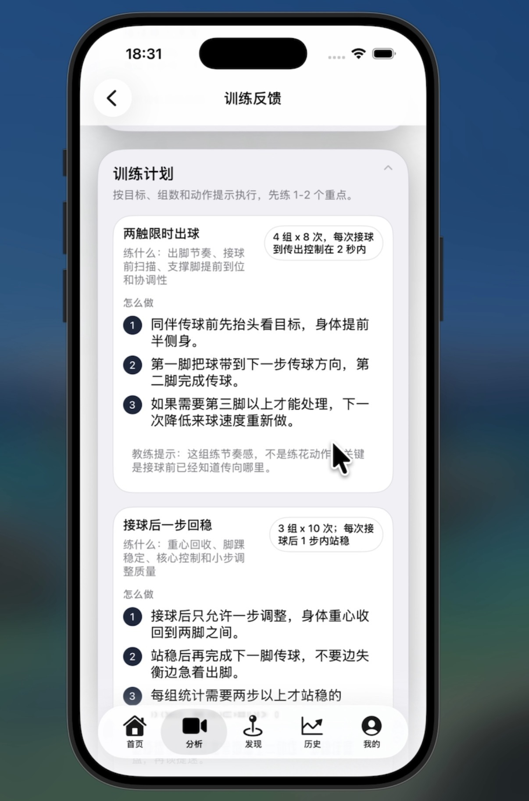
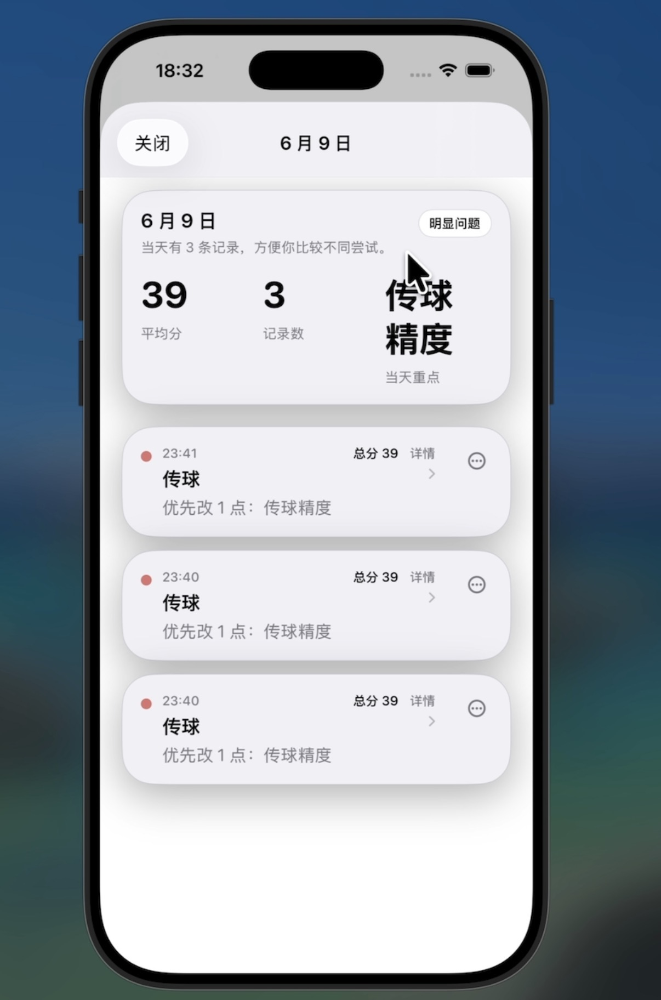
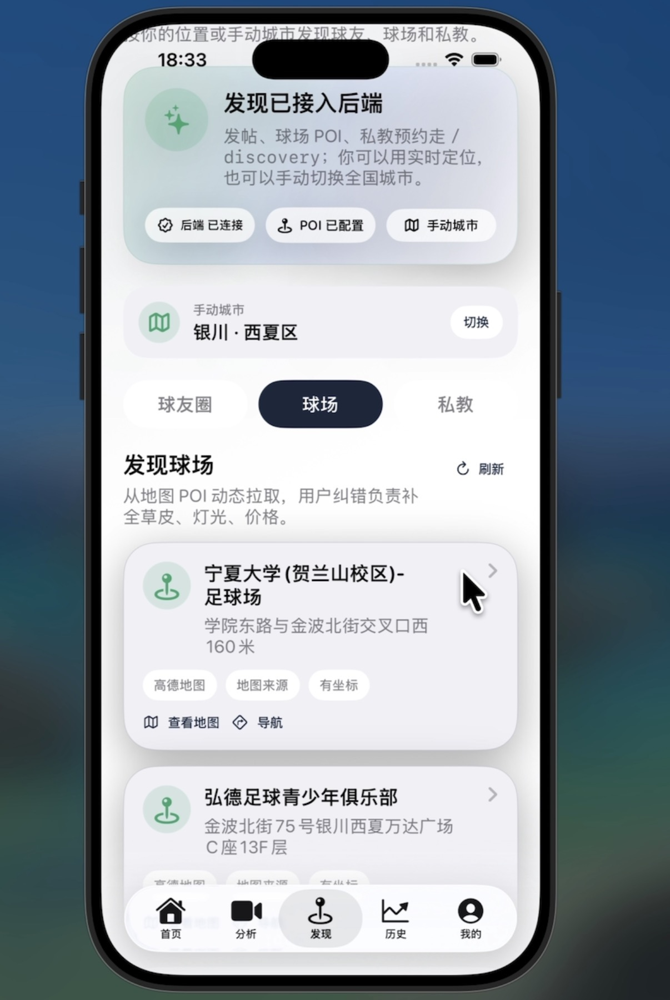
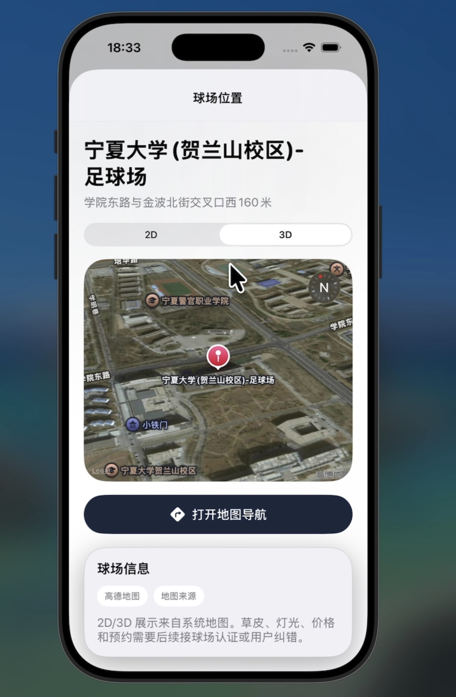

<div align="center">


# Kick

### 看清每一次动作，让下一次训练更有方向。

面向足球训练的 AI 辅助伙伴，将视频转化为对自身表现更清晰的理解。

[English](README.md) · **简体中文**

[为什么选择 Kick](#为比赛之间的每一次训练而设计) · [产品体验](#让每次训练形成闭环) · [快速开始](#快速开始) · [产品文档](backend/README.zh-CN.md)

<sub>足球专项分析 · 围绕视频复盘 · 原生 iOS 体验</sub>

</div>

---

## 看见真实的 Kick

以下原型界面来自项目作品集，展示从进入分析、回看动作到下一组训练的产品体验。点击图片可查看原图。

<p align="center">
<a href="docs/assets/screenshots/home.jpg"></a>
<a href="docs/assets/screenshots/video-review.jpg"></a>
<a href="docs/assets/screenshots/training-plan.jpg"></a>
</p>

**01 / 带着重点开始** · **02 / 回看具体动作** · **03 / 把建议带回训练**

图片保留开发阶段的原始中文界面。画面中的分数、时间点与建议用于展示原型体验，不代表经过独立验证的训练效果或识别准确率。

## 为比赛之间的每一次训练而设计

努力发生在球场上，理解这些努力需要复盘：这次传球如何起脚，控制在哪个环节出现变化，下一次又该把注意力放在哪里？

Kick 为希望带着目标训练的球员而设计。它将足球动作分析、视频复盘和具体反馈连接在同一个流程中，帮助你从“看完一段视频”，走向“为下一次训练确定一个重点”。

**产品的目标很明确：让有用的训练反馈，成为日常足球的一部分。**

## 看清动作，找到训练重点

<table>
<tr>
<td width="33%" valign="top"><strong>看清自己的技术</strong><br /><br />通过足球专项动作评估，进一步观察准备、支撑、触球与随挥。</td>
<td width="33%" valign="top"><strong>理解反馈的意义</strong><br /><br />结合评分阅读问题说明与训练提示，让复盘拥有具体方向。</td>
<td width="33%" valign="top"><strong>带着重点再次上场</strong><br /><br />回看原视频与训练历史，确定下一次想要关注的动作环节。</td>
</tr>
</table>

### 围绕足球动作设计

传球、射门与第一脚触球，对球员提出不同要求。Kick 的分析沿着这些差异展开，通过专项动作模板，将反馈落到具体的足球动作上。

| 训练方向 | 产品希望帮助你观察什么 |
| --- | --- |
| **传球** | 准备姿态、支撑脚位置、触球与控制稳定性 |
| **射门** | 准备、起脚触球到随挥之间，动作如何组织与衔接 |
| **接球** | 第一脚触球前的准备、控制表现与后续处理条件 |
| **传接球序列** | 连续处理过程中，各个动作如何连接 |
| **单一球员长视频** | 正在开发中的单一球员跟踪与候选动作片段定位流程 |

### 让反馈回到下一次练习

Kick 将动作评分、阶段评估、问题说明与下一步提示结合起来，希望每次复盘都能落到一个具体问题：再次训练时，哪个动作环节值得重点关注？

视频始终处于体验中心。回到原始动作，在上下文中理解反馈，用它辅助自己的判断与复盘。

### 陪伴连续的训练过程

上传、分析、回放与历史记录，被连接在同一个原生 iOS 应用中。Kick 希望让训练后的复盘成为自然习惯，并通过历史记录入口重新查看之前的影像与反馈。

## 让每次训练形成闭环

1. **确定重点。** 选择本次想要复盘的足球动作。
2. **带入影像。** 从 iOS 应用上传训练片段。
3. **理解反馈。** 查看动作评分、问题说明与分析质量。
4. **带着方向继续。** 回看视频，确定下一次训练想要关注的环节。

**记录 → 理解 → 复盘 → 带着目标再练一次**

## 从个人训练，走向更完整的足球体验

Kick 的核心，是球员、训练影像与下一次练习之间的联系。更长远的产品方向，是将个人训练连接到身边的足球生活：去哪里踢、和谁一起练，以及如何持续参与。

仓库中已有球友圈、球场查询、教练列表与预约界面和接口，为这一方向提供基础。这些部分仍在持续开发与验证中。

### 将训练放回完整场景

<p align="center">
<a href="docs/assets/screenshots/training-history.jpg"></a>
<a href="docs/assets/screenshots/venue-search.jpg"></a>
<a href="docs/assets/screenshots/venue-detail.jpg"></a>
</p>

**训练历史** · **球场发现** · **地图与导航**

历史记录让之前的训练重新进入视野。球场界面展示正在开发中的发现体验，包括地点详情与导航入口。

## 产品与工程

产品体验由 SwiftUI iOS 应用与 Python/FastAPI 分析服务支撑，视觉处理使用 OpenCV 与 MediaPipe。

<details>
<summary><strong>查看实现依据</strong></summary>

| 基础能力 | 实现依据 |
| --- | --- |
| 足球专项分析 | [动作路由](backend/analysis/analyzer_router.py) · [动作评分](backend/analysis/football_scoring.py) |
| 分析质量说明 | [帧率、姿态可见度与球轨迹检查](backend/quality_gate.py) |
| 目标连续性 | [位置、尺度与外观跟踪](backend/analysis/target_tracking.py) |
| 客户端与服务 | [iOS 文档](ios/KickAI/README.zh-CN.md) · [后端与 API](backend/README.zh-CN.md) |

</details>

### 当前状态与分析范围

Kick 仍在持续开发中。仓库展示当前实现，以上产品方向不代表已达到正式发布标准，也不代表训练效果已经过独立验证。长视频与发现流程仍需进一步按场景验证，教练界面不代表相关服务已正式履约上线。

分析受拍摄条件与动作类型影响。请结合原视频理解反馈，并检查分析状态与告警；HTTP 请求成功本身不代表分析结果有效。

## 快速开始

### 1. 启动分析服务

需要 Python 3.10 或更高版本；依赖未锁定，具体环境兼容性需在本机验证。

```bash
git clone https://github.com/kodiak-10/kick.git
cd kick/backend
python3 -m venv .venv
source .venv/bin/activate
python -m pip install -r requirements.txt
python -m uvicorn main:app --host 0.0.0.0 --port 8000
```

启动后查看 [健康状态](http://127.0.0.1:8000/health) 与 [交互式 API 文档](http://127.0.0.1:8000/docs)。确认健康响应中的视频分析服务可用，并检查启动告警。

球场查询的地图配置、上传示例和状态说明见 [后端文档](backend/README.zh-CN.md)。

### 2. 运行 iOS 应用

1. 在 macOS 上用支持 iOS 17 SDK 的 Xcode 打开 `ios/KickAI/Kick.xcodeproj`。
2. 选择 `KickAI` scheme，以及 iOS 17 或更高版本的模拟器或设备。
3. 模拟器默认连接 `http://127.0.0.1:8000`。真机需在 Xcode 的 **Edit Scheme → Run → Arguments → Environment Variables** 设置：

```text
KICKAI_ANALYZE_DEVICE_BASE_URL=http://<Mac 的局域网 IP>:8000
```

真机与 Mac 需要网络互通。完整配置见 [iOS 文档](ios/KickAI/README.zh-CN.md)。

## 仓库导航

```text
kick/
├── ios/KickAI/          主 SwiftUI 应用、Xcode 工程与测试
├── ios/AICoach/         早期 iOS 实现，保留供参考
├── backend/
│   ├── main.py         FastAPI 服务入口
│   ├── analysis/       动作路由、视频分析、跟踪与评分
│   ├── vision/         姿态检测与关键点处理
│   ├── tests/          后端测试与样例
│   ├── docs/           研究资料、使用说明与规划
│   └── schemas/        数据结构定义
└── docs/               网页演示文件
```

以代码与当前接口为准；`backend/docs/` 中的规划文档包含尚待实施的设想。

## 开发与验证

后端测试：

```bash
cd backend
python -m pytest
```

iOS 测试：在 Xcode 中选择 `KickAI` scheme 后执行 **Product → Test**。

测试目录覆盖动作路由、评分、视频结果一致性及客户端模型等方向。测试通过情况应以实际运行结果为准。

## 反馈与协作

欢迎通过 [Issues](https://github.com/kodiak-10/kick/issues) 提交问题。请附上复现步骤、运行环境、所选动作和实际结果；分享视频与日志前，请移除个人信息和凭据。

提交改动前，请说明变更目的与验证结果。地图密钥、用户视频、本地数据库及生成报告应保留在本地。
